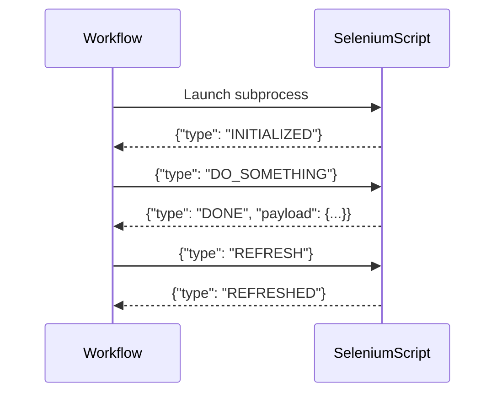

# TargetedContentBridge Documentation

## Overview

`TargetedContentBridge` is a Python class designed to facilitate structured, asynchronous communication between your main workflow process and subprocesses (such as Selenium scripts). It enables message-based interaction using JSON over standard input/output, allowing the workflow to send commands and receive events or data from the Selenium script in a robust, extensible way.

---

## Class: TargetedContentBridge

### Constructor

```python
def __init__(self, process, logger)
```
- **process**: An asyncio subprocess object (with `.stdin` and `.stdout`).
- **logger**: An async logger object for logging messages.

### Methods

#### registerHandler

```python
def registerHandler(self, message_type, handler)
```
- **message_type**: `str` — The type of message to handle (e.g., "INITIALIZED", "ERROR").
- **handler**: `async function` — The coroutine to call when a message of this type is received.

Registers a handler for a specific message type. When a message of this type is received, the handler is called with the message payload.

---

#### startListeningForOutput

```python
async def startListeningForOutput(self)
```
Begins listening for output from the subprocess. For each line received, it decodes the JSON message and dispatches it to the appropriate handler.

---

#### send

```python
async def send(self, message_type: str, payload=None)
```
- **message_type**: `str` — The type of message to send.
- **payload**: `dict` (optional) — The message payload.

Sends a JSON message to the subprocess via its stdin.

---

## Message Format

All messages sent/received are JSON objects with the following structure:

```json
{
  "type": "MESSAGE_TYPE",
  "payload": { ... }
}
```

---

# Integrating New Selenium Scripts

To integrate a new Selenium script with the workflow using `TargetedContentBridge`, follow these guidelines:

## 1. Script Communication Protocol

- **Input**: The script should read commands from `stdin` (one line per command, JSON-formatted).
- **Output**: The script should write events or responses to `stdout` (one line per message, JSON-formatted, ending with `\n`).

## 2. Script Startup

- On startup, the script should print an "INITIALIZED" message when ready:
  ```python
  print(json.dumps({"type": "INITIALIZED", "payload": {}}), flush=True)
  ```

## 3. Handling Commands

- The script should listen for lines from `stdin`, parse them as JSON, and act on the `"type"` field.
- Example:
  ```python
  import sys, json

  for line in sys.stdin:
      msg = json.loads(line)
      if msg["type"] == "REFRESH":
          # Perform refresh logic
          print(json.dumps({"type": "REFRESHED", "payload": {}}), flush=True)
  ```

## 4. Sending Events

- When the script wants to notify the workflow of an event (e.g., error, completion, data), it should print a JSON message to `stdout`:
  ```python
  print(json.dumps({"type": "ERROR", "payload": {"message": "Something went wrong"}}), flush=True)
  ```

## 5. Example Integration Flow

1. **Workflow** launches the Selenium script as a subprocess and wraps it with `TargetedContentBridge`.
2. **Workflow** registers handlers for expected message types (e.g., "INITIALIZED", "ERROR", "DATA").
3. **Workflow** calls `startListeningForOutput()` to begin processing messages.
4. **Workflow** sends commands to the script using `send()`.
5. **Script** reads commands from `stdin`, acts, and prints responses/events to `stdout`.

---

## Example: Minimal Selenium Script Skeleton

```python
import sys, json

def main():
    # Signal ready
    print(json.dumps({"type": "INITIALIZED", "payload": {}}), flush=True)

    for line in sys.stdin:
        msg = json.loads(line)
        if msg["type"] == "DO_SOMETHING":
            # ... perform action ...
            print(json.dumps({"type": "DONE", "payload": {"result": "ok"}}), flush=True)

if __name__ == "__main__":
    main()
```

---

## Best Practices

- Always flush stdout after printing a message (`flush=True`).
- Use unique `"type"` values for each kind of event/command.
- Keep messages one-per-line, JSON-encoded.
- Handle unexpected messages gracefully and log errors.

---

## Summary Diagram



---

Let me know if you want a more detailed example or a template for a new Selenium script! 